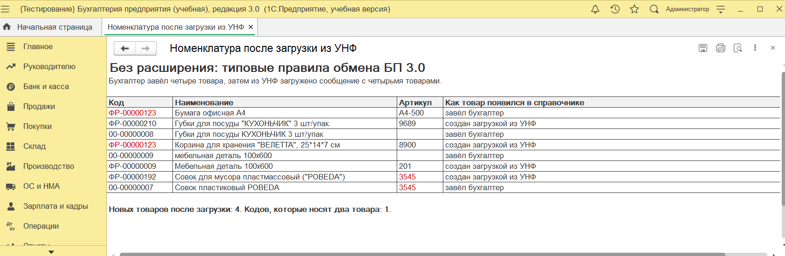
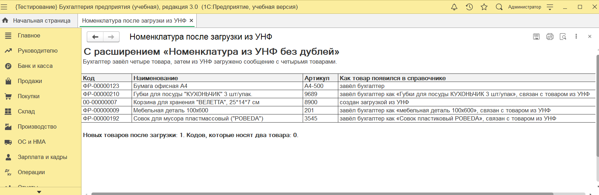

# Номенклатура из УНФ в «Бухгалтерию» без дублей

Частая связка в небольшой фирме: управленческий учёт ведут в «Управлении нашей фирмой», бухгалтерию в «Бухгалтерии предприятия 3.0», между ними синхронизация через EnterpriseData. К моменту настройки синхронизации бухгалтер обычно уже завёл в БП часть товаров сам, со своими названиями и без групп. При первой загрузке из УНФ типовые правила обмена эти товары не узнают и заводят рядом вторые. Если код товара из УНФ в БП уже занят, в справочнике появляются два товара с одним кодом.

Это расширение для БП 3.0 ищет товар из УНФ по всему справочнику: сначала по артикулу, потом по наименованию без учёта регистра, кавычек, знаков препинания и латинских букв, похожих на русские. Код из УНФ товар получает, только если в БП он свободен. Типовые модули не изменены, конфигурация остаётся на поддержке.

Бухгалтер завёл в БП четыре товара, затем из УНФ загружено сообщение с четырьмя товарами. На типовых правилах обмена в справочнике стало на четыре товара больше, совок, губки и деталь задвоились, а код ФР-00000123 носят два товара:



С расширением три товара из УНФ связались с теми, что завёл бухгалтер, новой стала только корзина, и она получила свободный код БП:



## Почему задваивается

Товары из УНФ загружает правило конвертации `Справочник_Номенклатура_Получение` в модуле `МенеджерОбменаЧерезУниверсальныйФормат13` (форматы 1.3–1.6). Если товара с тем же идентификатором в БП нет, правило ищет его по трём наборам полей: полное наименование, артикул, наименование. В каждый набор входит группа (`Родитель`), а строки сравниваются в запросе буква в букву. Товар из УНФ приходит со своей группой, у бухгалтера такой товар лежит в корне справочника или в другой группе, поэтому ни один набор не срабатывает, даже с тем же артикулом.

Код переносится из `КодВПрограмме` как есть. Объекты из обмена записываются в режиме загрузки, и платформа не проверяет уникальность кода.

## Что делает расширение

1. Типовой поиск выполняется первым. Если он нашёл товар, расширение ничего не меняет.
2. Иначе ищет товар БП с тем же артикулом во всём справочнике. Артикулы сравниваются без пробелов и регистра, латинская «a» равна русской «а». Если артикул в БП у двух товаров, берёт тот, у которого совпадает и наименование.
3. Если по артикулу никого нет, ищет по наименованию и полному наименованию. Из названия остаются только буквы и цифры в нижнем регистре, «ё» становится «е», латинские a, b, c, e, h, k, m, o, p, t, x, y становятся похожими русскими. Губки «КУХОНЬЧИК» с кавычками и точкой и без них, «100x600» с латинской x и «100х600» с русской сравниваются как одно и то же.
4. Одинаковое наименование при разных артикулах считает разными товарами: так бывает с размерами.
5. Если подходят два товара БП или больше, не выбирает ни один. Товар из УНФ заводится новым, а в журнале регистрации остаётся просьба сопоставить вручную.
6. Не подбирает товары, помеченные на удаление. При синхронизации через план обмена не подбирает и товары, уже связанные с другими товарами УНФ. Один товар БП не достанется двум товарам из одного сообщения.
7. Если код из УНФ в БП занят другим товаром, новый товар получает следующий код БП, а найденный товар сохраняет свой.
8. Каждое сопоставление и каждое предупреждение пишет в журнал регистрации, событие «Обмен данными.Номенклатура без дублей».

Найденный товар БП дальше синхронизируется как обычно: получает наименование и группу из УНФ, код тоже, если он в БП свободен. Следующие загрузки находят его уже без расширения, по связи с товаром УНФ.

## Что было и что стало

Сообщение выгружено из демобазы УНФ 3.0: четыре товара с группами. В БП перед загрузкой заведены товары так, как их мог завести бухгалтер.

| Товар в БП до синхронизации | Товар в УНФ | Типовая загрузка | С расширением |
|---|---|---|---|
| «Совок пластиковый POBEDA», арт. 3545, без группы | «Совок для мусора пластмассовый ("POBEDA")», арт. 3545 | второй совок | найден по артикулу |
| «Губки для посуды КУХОНЬЧИК 3 шт/упак», без артикула | «Губки для посуды "КУХОНЬЧИК" 3 шт/упак.», арт. 9689 | вторые губки | найдены по наименованию |
| «мебельная деталь 100x600» с латинской x | «Мебельная деталь 100х600» | вторая деталь | найдена по наименованию |
| «Бумага офисная А4» с кодом ФР-00000123 | корзина «ВЕЛЕТТА» с кодом ФР-00000123 | два товара с одним кодом | корзина получила новый код БП |
| два товара с артикулом 3545 | совок, арт. 3545 | третий совок | третий совок и предупреждение в журнале |
| «Губки для посуды "КУХОНЬЧИК" 3 шт/упак.», арт. 1111 | те же губки, арт. 9689 | отдельный товар | отдельный товар: артикулы разные |

## Как проверено

Автотесты на учебной БП. Тесты прогоняются два раза на копии базы, восстановленной из эталона: на типовых правилах обмена, чтобы было видно, что ошибка воспроизводится, и с установленным расширением. Каждый сценарий идёт в транзакции, которая в конце отменяется: заводит товары в БП, загружает сообщение типовой обработкой «Выгрузка и загрузка EnterpriseData» и проверяет справочник. Без расширения 21 проверка, с расширением 37, все проходят. Отрывок отчёта:

```
Без расширения: типовые правила обмена БП 3.0.67, EnterpriseData 1.6.

Артикул тот же, наименование и группа другие
  ok    товаров с артикулом 3545: типовая загрузка завела совок вторым товаром
Код из УНФ в БП уже занят другим товаром
  ok    товаров с кодом ФР-00000123: типовая загрузка отдала код бумаги корзине

С расширением «Номенклатура из УНФ без дублей».

Артикул тот же, наименование и группа другие
  ok    товаров с артикулом 3545
  ok    товар БП получил наименование совка из УНФ
  ok    в журнале запись о сопоставлении по артикулу
Латинская x вместо русской х в размере
  ok    деталь из УНФ связана с товаром БП, он получил артикул 201
Код из УНФ в БП уже занят другим товаром
  ok    товаров с кодом ФР-00000123
  ok    корзина получила новый код БП
Артикул в БП у двух товаров
  ok    товаров с артикулом 3545: оба товара БП и совок из УНФ
  ok    в журнале просьба сопоставить вручную
Повторная загрузка того же сообщения
  ok    вторая загрузка не добавила товаров
  ok    кодов, которые носят два товара
Объём: 1 900 товаров в БП
  ok    загрузка быстрее 10 с
        загрузка сообщения заняла 5,1 с
```

На 1 900 товарах сообщение загружается за 5,1 с, на типовых правилах за 4,6 с. Больше товаров учебная версия платформы в справочник не пускает, её предел 2 000 записей. Тесты загружают сообщение без узла плана обмена, поэтому пропуск товаров, уже связанных с УНФ через узел, ими не проверен. Полный отчёт: [tests/report.txt](tests/report.txt).

## Как установить

1. В БП открыть «Администрирование → Печатные формы, отчеты и обработки → Расширения», нажать «Добавить из файла...» и выбрать `build/НоменклатураБезДублей.cfe`.
2. У расширения снять флажок «Безопасный режим». В безопасном режиме платформа не даёт расширению перехватывать модули обмена: расширение установится, но работать не будет, а в журнале регистрации появится «Ошибка расширения модуля... подключено в безопасном режиме».
3. Перезапустить программу и запустить синхронизацию с УНФ как обычно.

В базовой версии БП пункта «Расширения» нет: базовые версии расширения не подключают.

После загрузки сопоставления видно в журнале регистрации, отбор по событию «Обмен данными.Номенклатура без дублей»:

```
Товар «Совок для мусора пластмассовый ("POBEDA")» из УНФ сопоставлен по артикулу с товаром БП «Совок пластиковый POBEDA».
Товар «Губки для посуды "КУХОНЬЧИК" 3 шт/упак.» из УНФ сопоставлен по наименованию с товаром БП «Губки для посуды КУХОНЬЧИК 3 шт/упак».
Товар «Мебельная деталь 100х600» из УНФ сопоставлен по наименованию с товаром БП «мебельная деталь 100x600».
Код ФР-00000123 товара «Корзина для хранения "ВЕЛЕТТА", 25*14*7 см» из УНФ в БП уже занят товаром «Бумага офисная А4», товар получит новый код БП.
```

## Устройство

* `src/НоменклатураБезДублей/` исходники расширения в формате выгрузки конфигуратора. Расширение заимствует два общих модуля и добавляет один свой:
  * `МенеджерОбменаЧерезУниверсальныйФормат13`: перехват `&После` обработчика `ПриКонвертацииДанныхXDTO` подбирает товар БП, перехват `&После` обработчика `ПередЗаписьюПолученныхДанных` проверяет код;
  * `ОбменДаннымиXDTOСервер`: перехват `&Вместо` функции `СсылкаОбъектаПоСвойствамОбъектаXDTO` вызывает типовой поиск через `ПродолжитьВызов` и возвращает подобранный товар, только если типовой поиск ничего не нашёл;
  * `нбд_СопоставлениеНоменклатуры`: индекс артикулов и наименований, правила подбора, ключи сравнения, журнал. Индекс строится одним запросом за загрузку и живёт в компонентах обмена БСП.
* `build/НоменклатураБезДублей.cfe` собранное расширение.
* `tests/` обработка с автотестами и сообщение `fixtures/ed_unf_items.xml`, выгруженное из демобазы УНФ типовой обработкой «Выгрузка и загрузка EnterpriseData».
* `tools\build.ps1 -Base <база БП>` собирает расширение и тесты из исходников. `tools\test.ps1 -Base <база БП> -Reference <копия 1Cv8.1CD> -Build` собирает, восстанавливает базу из эталона, гоняет тесты без расширения, ставит расширение, гоняет ещё раз и снова восстанавливает базу.
* `tools/shots.ps1` снимки для README.

Проверено на «Бухгалтерии предприятия (учебной)» 3.0.67.54 с режимом совместимости 8.3.12, платформа 8.5.1, файловый режим, формат EnterpriseData 1.6. Сообщение выгружено из «Управления нашей фирмой (учебной)» 3.0.13.251. Свежие релизы БП знают новые версии формата, и правила для них могут лежать в других модулях. Поэтому перед установкой расширение стоит проверить на копии своей базы: если правило `Справочник_Номенклатура_Получение` для вашей версии формата живёт в другом модуле, перехваты переносятся на него. С рабочей базой расширение не запускалось.

## Нужна доработка обмена?

Настрою синхронизацию УНФ или УТ 11 с БП 3.0 через EnterpriseData и доработаю правила обмена под ваши справочники расширением, конфигурация останется на поддержке. Telegram: @MATb_CONTROL
